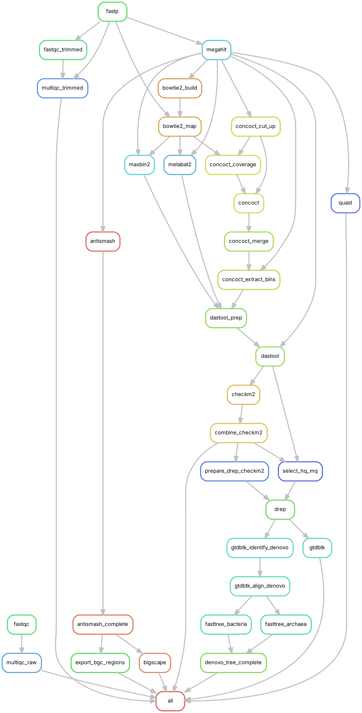

<h1 align="center">unexBGC</h1>

<p align="center">
  <b>From raw metagenomic reads to biosynthetic gene clusters, in one reproducible workflow</b>
</p>

<p align="center">
  
  
  
  
</p>

---

**unexBGC** finds biosynthetic gene clusters (BGCs), the groups of genes microbes use to make natural products, in **marine metagenomes**. Starting from paired-end sequencing reads, it reconstructs metagenome-assembled genomes (MAGs), classifies them taxonomically, detects BGCs and identifies those that are potentially novel.

It was built for microbiologists without extensive bioinformatics experience: you edit **one sample sheet** and **one settings file**, and Snakemake runs every step in the right order, locally or on an HPC cluster.

### The pipeline provides

**Quality-checked genomes**: HQ and MQ MAGs, dereplicated, with completeness and contamination for each

**Taxonomy and phylogeny**: GTDB classification plus separate bacterial and archaeal trees ready for iTOL

**BGC catalogue**: one table listing every cluster with its product class, location and closest known relative

**Novelty assessment**: gene cluster families compared against the MIBiG database of characterised clusters


## Workflow


*Blue arrows: read processing; red: BGC branch (antiSMASH runs on assembled contigs); green: MAG branch. Figure created in BioRender.com.*

<details>
<summary>Detailed Snakemake rule graph</summary>



</details>

| Stage | Tools | Main output |
|---|---|---|
| Read quality control | FastQC, fastp, MultiQC | `results/qc/` |
| Assembly | MEGAHIT (contigs ≥ 1500 bp), QUAST | `results/assembly/megahit/{sample}/{sample}.fa` |
| Read mapping | Bowtie2, SAMtools | `results/mapping/` |
| Binning | MetaBAT2, MaxBin2, CONCOCT | `results/binning/{tool}/` |
| Bin refinement | DAS Tool | `results/binning/dastool/` |
| MAG quality | CheckM2; HQ (≥ 90% complete, ≤ 5% contaminated) and MQ (≥ 50%, ≤ 10%) selection | `results/binning/checkm2/CheckM2_all_samples.csv` |
| Dereplication | dRep (95% ANI) | `results/binning/drep/dereplicated/dereplicated_genomes/` |
| Taxonomy and phylogeny | GTDB-Tk, FastTree (separate bacterial and archaeal trees) | `results/taxonomy/` |
| BGC detection | antiSMASH (with MIBiG comparison) | `results/bgc/antismash/{sample}/` |
| BGC summary table | `workflow/scripts/export_bgc_regions.py` | `results/bgc/bgc_regions.tsv` |
| BGC clustering and novelty | BiG-SCAPE 2 with MIBiG 4.0 references | `results/bgc/bigscape/` |

## Requirements

- Linux (tested on Ubuntu and the CHPC Lengau cluster)
- Snakemake ≥ 8
- Conda or Mamba (each step installs its own environment from `workflow/envs/`)
- Reference databases, downloaded once:
  - CheckM2 database (`checkm2 database --download`)
  - GTDB-Tk reference data (see the GTDB-Tk documentation)
  - Pfam-A HMM file for BiG-SCAPE
  - antiSMASH databases (`download-databases` after installing antiSMASH)

## Quick start

```bash
git clone https://github.com/Hildred22/unexBGC.git
cd unexBGC

# 1. Put your raw reads in data/raw/
# 2. List your samples in config/samples.tsv
# 3. Set database paths and threads in config/config.yaml

# Check what will run (dry run)
snakemake -n

# Run locally with 24 cores
snakemake --use-conda --cores 24
```

To run only up to a certain stage, name its output, for example:

```bash
snakemake --use-conda --cores 24 results/binning/checkm2/CheckM2_all_samples.csv
```

### Running on an HPC cluster (PBS)

A profile for the CHPC Lengau cluster is provided in `profiles/chpc/`. Replace `YOUR_PROJECT` with your project code, then:

```bash
pip install snakemake-executor-plugin-cluster-generic
snakemake --profile profiles/chpc
```

Each rule is submitted as its own PBS job; logs are written to `logs/`.

## Input data

The pipeline requires paired-end metagenomic reads in compressed FASTQ (`.fastq.gz`) format, placed in `data/raw/`. Raw sequencing data are not included in this repository.

### Sample sheet format

`config/samples.tsv` is tab-separated with three columns:

```text
sample    read1                  read2
sample1   sample1_R1.fastq.gz    sample1_R2.fastq.gz
sample2   sample2_R1.fastq.gz    sample2_R2.fastq.gz
```

Sample names should be unique and contain no spaces.

## Configuration

All settings are in `config/config.yaml`:

- `samples` – path to the sample sheet
- `input_dir` – folder with raw reads
- `dastool_db`, `checkm2_db`, `gtdbtk_db`, `bigscape_pfam` – database paths
- `threads` – CPU threads per step

## Main outputs

| File | Description |
|---|---|
| `results/qc/multiqc_trimmed/multiqc_report.html` | Read quality before and after trimming |
| `results/assembly/quast/{sample}/report.html` | Assembly statistics per sample |
| `results/binning/checkm2/CheckM2_all_samples.csv` | Completeness and contamination of every refined bin |
| `results/binning/drep/dereplicated/dereplicated_genomes/` | Final dereplicated MAGs (HQ + MQ) |
| `results/taxonomy/gtdbtk/` | GTDB taxonomy of each MAG |
| `results/taxonomy/denovo/*.nwk` | Bacterial and archaeal trees (e.g. for iTOL) |
| `results/bgc/bgc_regions.tsv` | One row per BGC region: sample, contig, coordinates, product class, contig-edge status and closest known cluster |
| `results/bgc/bigscape/` | Gene cluster families and links to MIBiG reference clusters |

## Repository structure

```text
unexBGC/
├── Snakefile                 # main workflow, defines final outputs
├── config/
│   ├── config.yaml           # settings and database paths
│   └── samples.tsv           # sample sheet
├── workflow/
│   ├── rules/                # one .smk file per pipeline stage
│   ├── envs/                 # conda environment per tool
│   └── scripts/              # helper Python scripts
├── profiles/chpc/            # PBS cluster profile
├── docs/                     # workflow diagram
└── data/                     # raw reads go in data/raw/ (not tracked)
```

## Reproducibility

The workflow is implemented in Snakemake, so each step runs only when its inputs change and the full analysis can be repeated on new datasets or systems. Software versions are fixed per step in `workflow/envs/`, and every step writes a log file to `logs/`.
